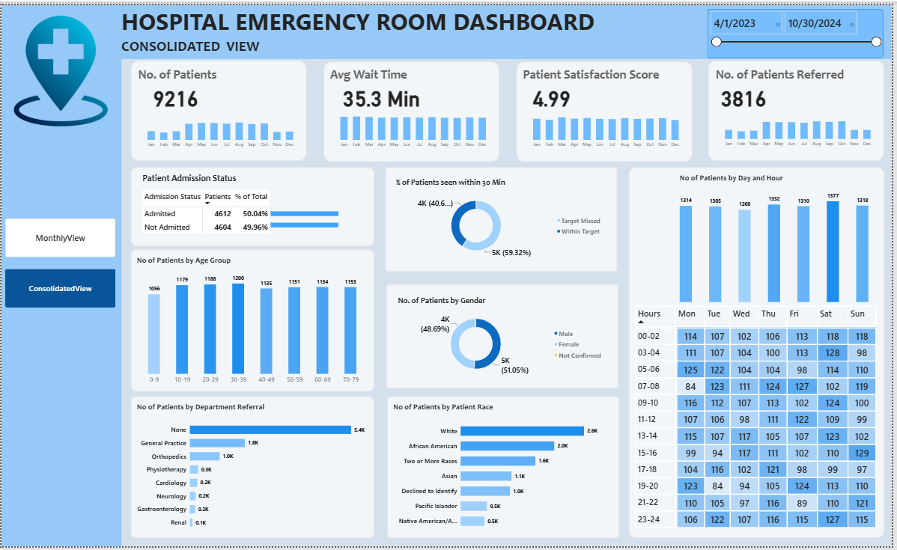
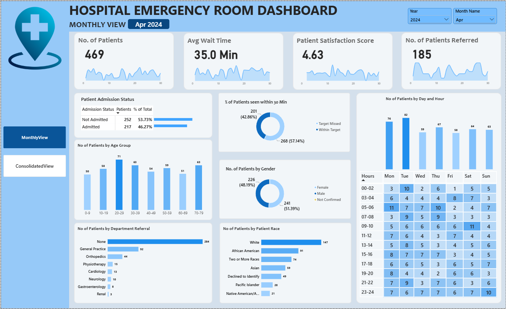

# Hospital Emergency Room Dashboard

An interactive Power BI report analysing 9,216 emergency room visits across 19 months (April 2023 to October 2024) to track patient volume, wait times, satisfaction and department referrals.

---

## Dashboard

### Consolidated View

A full-period overview with a date-range slicer, monthly KPI trends and patient breakdowns across the entire dataset.

### Monthly View

A month-level drill-down with Year and Month slicers and daily KPI trends for operational review.

---

## Skills Demonstrated

- Data cleaning and transformation in Power Query (data types, date formatting, handling blank and missing values)
- Data modelling: building a dedicated Date Table and defining relationships with the fact table
- Calculated columns in DAX: Age Group, Admission Hour, hourly admission intervals, wait-time target status and admission status
- DAX measures for KPIs: total patients, patients referred, average wait time, average satisfaction score and percentage of total
- KPI design and business metric definition (30-minute wait-time target)
- Interactive report design: slicers, page navigation buttons and a two-page layout for different audiences
- Data visualisation: KPI cards with trend charts, donut, bar and column charts, and a conditionally formatted day-by-hour heatmap
- Analytical thinking: turning raw operational data into actionable insights, including identifying data quality gaps

---

## Business Problem

Emergency departments operate under constant pressure to treat patients quickly while managing unpredictable demand and limited staff. Without a consolidated view of performance, hospital management struggles to answer essential operational questions: How many patients are arriving and when? Are patients being seen within an acceptable time? How satisfied are they with the care received? Which specialist departments receive the most referrals from the ER?

Raw visit records alone do not answer these questions in a form that supports timely decision-making.

## Objective

To design an interactive dashboard that gives hospital administrators and ER managers a clear, data-driven view of emergency room performance, enabling them to:

- Monitor patient volume and identify peak days and hours to support staffing decisions
- Measure wait-time performance against a 30-minute service target
- Track patient satisfaction and highlight gaps in feedback collection
- Understand patient demographics and admission outcomes
- Identify which departments receive the highest share of ER referrals to guide resource allocation

---

## Key Insights

- **Most patients miss the wait-time target.** Only 40.7% of patients were seen within 30 minutes; the remaining 59.3% waited longer, with an overall average wait of 35.3 minutes.
- **Delays are system-wide, not department-specific.** Average wait time varies only between 34.7 and 36.8 minutes across referral departments and is nearly identical for admitted and non-admitted patients, pointing to a process-level bottleneck rather than a single problem area.
- **Admission outcomes are evenly split.** 50.04% of patients were admitted to the hospital and 49.96% were not.
- **Referrals are concentrated in two departments.** 41.4% of patients (3,816) were referred to a specialist department. General Practice (48%) and Orthopedics (26%) together account for nearly three-quarters of all referrals.
- **Patient satisfaction data is largely incomplete.** Only 27.3% of patients submitted a satisfaction score, averaging 4.99 out of 10. The low response rate limits how reliably satisfaction can be measured and is itself an area for improvement.
- **Demand is steady, with identifiable peaks.** Monthly volume averages around 485 visits, ranging from 431 (February 2024) to 530 (August 2024). Saturday is the busiest day of the week, and admissions peak around 11 PM, 7 AM and 1 PM.
- **The ER serves all age groups almost equally.** Each 10-year age band from 10 to 79 accounts for a similar share of visits, with the 0-9 group slightly lower. Male patients make up 51.05% of visits and female patients 48.69%.

---

## Summary

This project transforms 9,216 raw emergency room records, sourced from Kaggle, into a two-page interactive Power BI dashboard. The data was cleaned in Power Query, modelled with a dedicated Date Table and relationships, and enriched with DAX calculated columns and measures to produce meaningful KPIs. The Consolidated View supports long-term performance review, while the Monthly View enables month-by-month operational monitoring.

The analysis shows that the majority of patients wait beyond the 30-minute target, that delays are consistent across all departments, and that satisfaction feedback is collected from only about a quarter of patients. These findings give hospital management a clear starting point for improving staffing during peak hours, reducing wait times and strengthening patient feedback processes.
